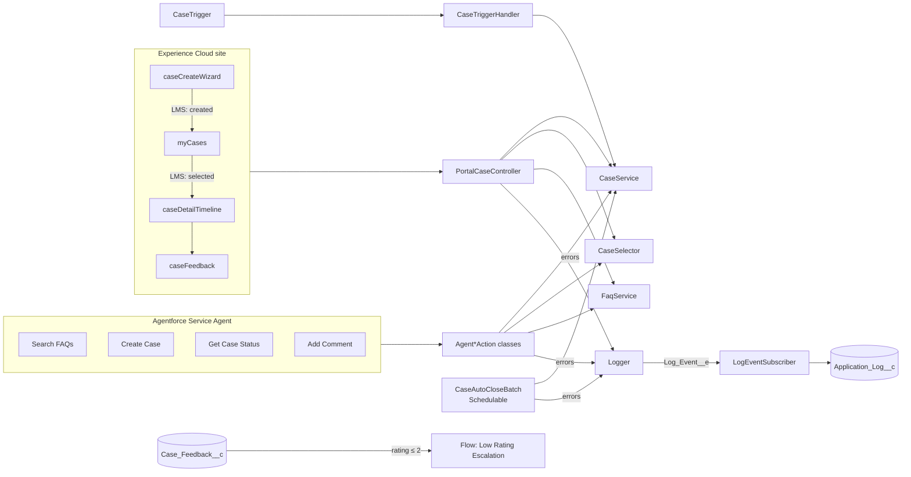

# Customer Support Portal with an Agentforce Service Agent

A Salesforce Service Cloud + Experience Cloud project in which customers log in, raise cases, follow their history, reply to the support team and rate the service. An **Agentforce service agent** answers common questions from an FAQ library, creates cases and reports case status.

> Built with Salesforce DX, Apex, Lightning Web Components, Flow, Platform Events and Agentforce.
> Every Apex class has a test class, and the LWCs have Jest tests. CI runs on GitHub Actions.

<!-- Add screenshots / demo GIF here, e.g.  -->

---

## Features

| Area | What it does |
|---|---|
| **Customer portal (Experience Cloud)** | Customers create cases with a 3-step wizard, see their cases, read the full history and reply. |
| **Case deflection** | While the customer types a subject, matching FAQs show up instantly (SOSL search with debounce). |
| **Smart defaults** | Source channel is detected automatically; portal and AI cases are prioritised by category. |
| **Spam protection** | A contact can't have more than _N_ open cases (configurable in Custom Metadata). |
| **Auto-close** | A nightly batch closes cases stuck in "Waiting on Customer" for more than _N_ days. |
| **CSAT feedback** | A star rating on closed cases. A rating of 2 or less re-opens the case as **Escalated** (record-triggered Flow). |
| **Agentforce agent** | Four Apex actions: Search FAQs, Create Case, Get Case Status (with email verification) and Add Comment. |
| **AI case summary** | An optional Prompt Builder template plus Apex (`ConnectApi.EinsteinLLM`) writes a summary to the case. |
| **Reliable logging** | Errors are published as a publish-immediately Platform Event, so logs survive transaction rollbacks. |

---

## Architecture



**Design choices**

- **Trigger framework.** One trigger per object and a handler class (`TriggerHandler`) with a per-handler bypass switch.
- **Service / Selector layers.** Business rules live in `CaseService` and all SOQL lives in `CaseSelector`, so the controller and agent actions stay thin.
- **Security by default.** Classes use `with sharing`, and queries and DML use `WITH USER_MODE` / `AccessLevel.USER_MODE`. Agent actions verify the customer's email before sharing case details.
- **Configuration over code.** `Support_Settings__mdt` holds the limits; nothing is hard-coded.
- **Bulk-safe.** Triggers and invocable actions handle 200+ records with one query per object.

---

## Skills demonstrated

| Skill | Where |
|---|---|
| Apex triggers and a handler framework | `TriggerHandler`, `CaseTrigger`, `CaseTriggerHandler` |
| Service and selector patterns | `CaseService`, `CaseSelector`, `FaqService` |
| SOQL (dynamic with binds, aggregate, subqueries) and SOSL | `CaseSelector`, `FaqService` |
| Security: sharing, USER_MODE, permission sets | All classes, `permissionsets/` |
| Batch Apex, Schedulable, Database.Stateful | `CaseAutoCloseBatch` |
| Platform Events | `Log_Event__e`, `Logger`, `LogEventSubscriber` |
| Invocable Apex for Agentforce | `Agent*Action` classes |
| Prompt Builder and the Einstein LLM API | `agentforce-extension/` |
| LWC: wire, imperative Apex, refreshApex, LMS, events, datatable | `lwc/` |
| Jest tests for LWC | `lwc/**/__tests__` |
| Flow (record-triggered) | `Case_Feedback_Low_Rating_Escalation` |
| Custom Metadata Types | `Support_Settings__mdt` |
| Validation rules | `Resolution_Required_On_Close` |
| Experience Cloud and Service Cloud setup | [docs/SETUP.md](docs/SETUP.md) |
| CI/CD with GitHub Actions and scratch orgs | `.github/workflows/ci.yml` |
| Static analysis (Code Analyzer / PMD) | CI job `code-analyzer` |

---

## Project structure

```
force-app/main/default/
├── classes/              Apex: controller, services, selectors, agent actions, batch, logger, tests
├── triggers/             CaseTrigger, LogEventTrigger
├── lwc/                  caseCreateWizard, myCases, caseDetailTimeline, caseFeedback, errorUtils
├── objects/              Case fields, Case_Feedback__c, FAQ__c, Application_Log__c,
│                         Log_Event__e (platform event), Support_Settings__mdt
├── flows/                Case_Feedback_Low_Rating_Escalation
├── permissionsets/       Support_Agent, Support_Portal_Customer
├── messageChannels/      CaseSelected
├── customMetadata/       Support_Settings.Default
└── standardValueSets/    CaseStatus (adds "Waiting on Customer" and "Escalated")
agentforce-extension/     Optional: AI case summary (needs an Agentforce-enabled org)
scripts/apex/             Sample data and job scheduling
docs/SETUP.md             Full setup guide (site, sharing, Omni-Channel, Agentforce)
```

---

## Quick start

```bash
# 1. Authorise your Dev Hub (once)
sf org login web --set-default-dev-hub --alias devhub

# 2. Create a scratch org and deploy
sf org create scratch --definition-file config/project-scratch-def.json --alias support-portal --set-default --duration-days 30
sf project deploy start --source-dir force-app

# 3. Permissions and demo data
sf org assign permset --name Support_Agent
sf apex run --file scripts/apex/sample-data.apex
sf apex run --file scripts/apex/schedule-jobs.apex

# 4. Run all Apex tests
sf apex run test --test-level RunLocalTests --code-coverage --result-format human --wait 20

# 5. LWC Jest tests
npm install
npm run test:unit
```

To build the Experience Cloud site, set up Omni-Channel and configure the Agentforce agent, see **[docs/SETUP.md](docs/SETUP.md)**.

---

## Demo script (2–3 minutes)

1. Log in to the portal as the customer and open **Get help**. Pick *Billing* and type "charged twice". The FAQ suggestion appears.
2. Submit the case. It appears in **My cases** straight away (Lightning Message Service) with **High** priority.
3. As an agent, set the case to *Waiting on Customer* and add a public comment.
4. Back as the customer, reply from the timeline. The case moves back to *Working* automatically.
5. Close the case and give it 1 star. The Flow re-opens it as **Escalated**.
6. Chat with the Agentforce agent: "What's the status of case 1002? My email is priya.sharma@example.com".

---

## What I'd add next

- An Entitlement Process with SLA milestones on the case timeline
- Data Cloud-grounded answers for the agent
- Named Credential integration with an external order system
- Additional components for Lightning Web Runtime (LWR) sites
